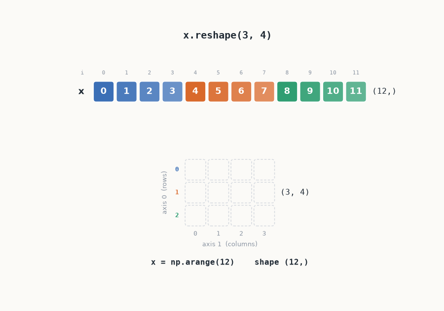
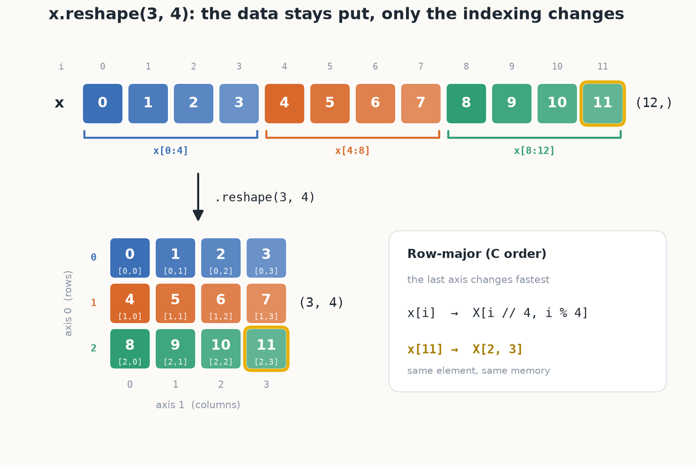
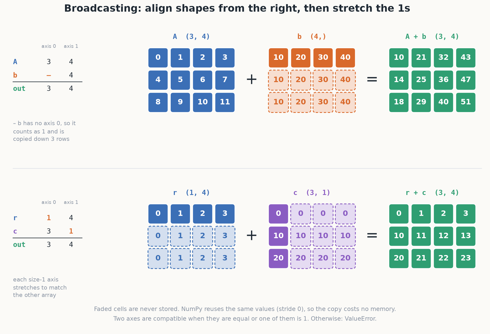

# Day 5: NumPy Arrays, Shapes & Broadcasting



Most shape bugs don't crash. A `(3,)` that should have been `(3, 1)` broadcasts happily into the wrong
answer, and you only find out three layers later. Today is about knowing the shape of every array at
every line, well enough to predict it before running the code.

Everything lives in [`numpy_ops/shapes.py`](numpy_ops/shapes.py), and every line that makes or changes an
array carries a `# shape: (...)` comment.

## Run it

```bash
cd 5_shape_inspect
python -m examples.run_all      # runs all five tasks and redraws figures/
pytest tests -v                 # 23 shape tests
```

## The three ideas, in pictures

**1. Reshape doesn't move data.** It changes how the same 12 numbers are indexed. NumPy fills the last
axis first (row-major), so flat index `i` lands at `[i // 4, i % 4]`.



**2. Reductions remove the axis you name.**

| On a `(2, 3)` array | Result shape | What happened |
|---|---|---|
| `X.sum()` | `()` | every axis collapsed |
| `X.sum(axis=0)` | `(3,)` | rows collapsed, columns remain |
| `X.sum(axis=1)` | `(2,)` | columns collapsed, rows remain |
| `X.sum(axis=1, keepdims=True)` | `(2, 1)` | axis kept with size 1, ready to broadcast back |

`.mean()` and `.max()` follow the same rule.

**3. Broadcasting lines shapes up from the right.** A missing axis counts as 1, and any axis of size 1
stretches to match. That's how a bias `(4,)` adds to every row of a `(3, 4)` batch with no loop.



## Why bother with NumPy at all

Same work, written twice, on a `(1000, 1000)` array:

| Operation | Python loops | NumPy | Speedup |
|---|---|---|---|
| element-wise multiply | ~0.22 s | ~0.9 ms | ~250x |
| row-wise mean | ~0.10 s | ~0.2 ms | ~450x |

The loop pays Python's overhead a million times. NumPy pays it once and hands the rest to compiled code.
Your numbers will differ, but the gap won't.

## Layout

```
5_shape_inspect
├── numpy_ops/shapes.py     # tasks 1-5
├── examples/run_all.py     # runs everything
├── examples/figures.py     # draws the three figures
├── figures/                # generated, don't edit by hand
├── tests/test_shapes.py
└── research-log/2026-11-05.md
```

The bugs I hit and what I'd still like to know are in the [research log](research-log/2026-11-05.md).

## Author

Emmanuel Adeloju — [github.com/Prodholly](https://github.com/Prodholly) · MIT License
