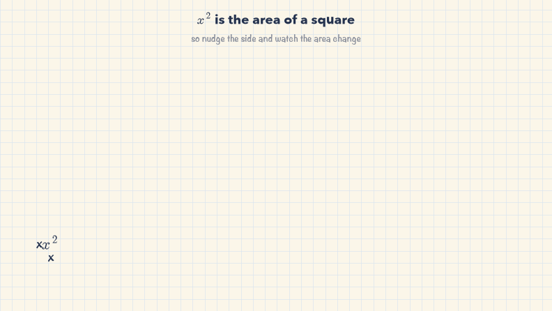
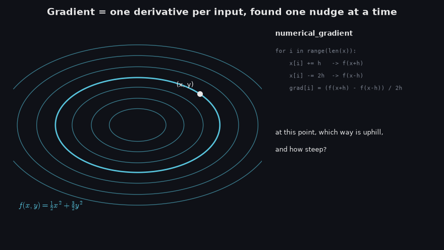
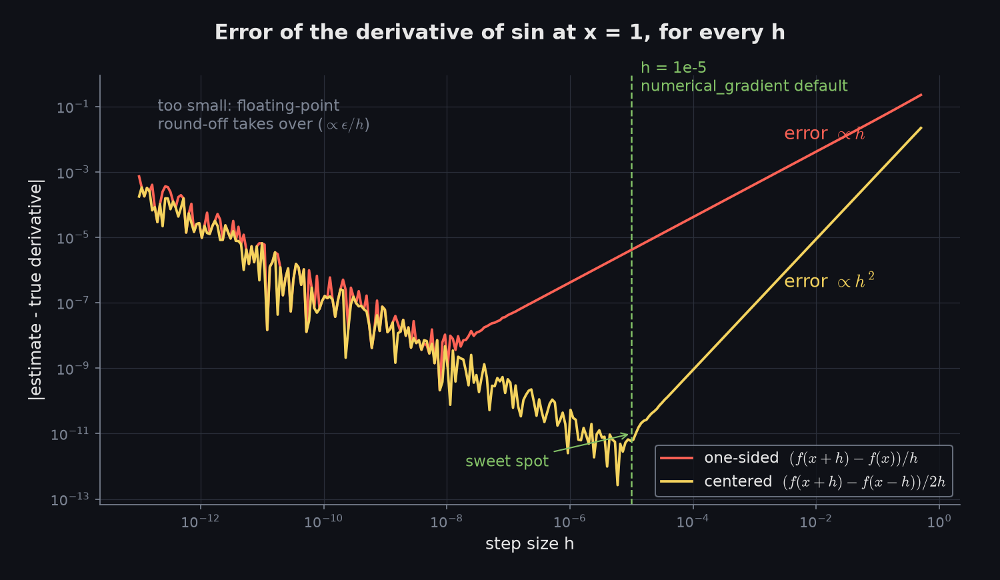

# Day 6: Gradient Checking & Vectorization Benchmarks

Gradient checking answers one question: is the gradient formula I derived actually right? It answers it with
nothing but the definition of a derivative. So before any code, here's that definition, built up from pictures.

## Start here: what a derivative really is

This is the note I made while watching 3Blue1Brown's *Essence of Calculus*:


If `A(x)` is the area under `y = x²`, then pushing `x` a tiny bit adds a thin sliver of area, `δA ≈ x² · δx`.
Rearranged, `δA / δx ≈ x²`. **The derivative is the ratio of a tiny change in output to the tiny change in input
that caused it.** Everything in today's build is that sentence turned into code.

### 1. A circle is a stack of rings


Each ring at radius `r` is about `2πr` long and `dr` thick. Unrolled, the rings stack into a triangle of area
`½ · R · 2πR = πR²`. Read backwards, the area grows by `2πr` per unit of radius: `dA/dr = 2πr`.

The last part of the animation shows the formula I'll use all day. Instead of nudging `r` one way, nudge it
both ways and take the band between `r − h` and `r + h`:

$$\frac{A(r+h) - A(r-h)}{2h}$$

For a circle this gives exactly `2πr` for every `h`. The one-sided version, `(A(r+h) − A(r)) / h`, is off by `πh`.

### 2. My note, animated


The green sliver isn't quite a rectangle. The red bit on top is the error, and it shrinks like `δx²`, faster
than the sliver itself, so it vanishes in the limit. Watch the error readout: the one-sided estimate is off by
about `x·h`, and the centered one by only `h²/3`.

### 3. Why centered beats one-sided



`x²` is the area of a square. Grow one side by `h` and you get two strips plus a little red corner `h²`. That
corner is exactly the error of the one-sided formula: `((x+h)² − x²) / h = 2x + h`.

Now grow by `h` and shrink by `h`. The two strips have lengths `x + h` and `x − h`, one too long and one too
short by the same amount, so the error cancels: `((x+h)² − (x−h)²) / 2h = 2x`, exactly. In general the
centered error is `O(h²)` instead of `O(h)`, and on the right the dashed secant lines up with the true slope.

### 4. From derivative to gradient



A loss depends on many inputs at once. The gradient is just one derivative per input: hold everything else
still, nudge one coordinate by `±h`, and measure. Do that for every coordinate and you have `numerical_gradient`.
The result points straight across the contour lines, uphill, and matches the analytical gradient `(x, 3y)` to
about `1e-11`.

### 5. How small should h be?



Smaller isn't always better. Below about `1e-8`, floating-point round-off swamps the estimate. The centered
formula bottoms out near `h = 1e-5`, which is why that's the default step size in `numerical_gradient`.

To redraw these figures, run this from `6_grad_check`:

```bash
python -m examples.calculus_intuition
```

## Credit

The ring, sliver and square pictures are the ones Grant Sanderson uses in the first two chapters of
[**3Blue1Brown, *Essence of Calculus***](https://youtube.com/playlist?list=PLZHQObOWTQDMsr9K-rj53DwVRMYO3t5Yr&si=guWmcdNLRhyTxTgw).
The animations here are my own versions, drawn with matplotlib, but the way of seeing it is his. Watch the
originals.

---

*The gradient checker, the softmax + cross-entropy check, and the vectorization benchmark are next.*
