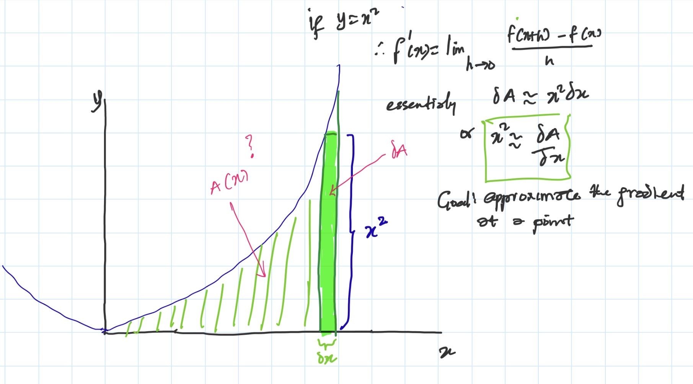
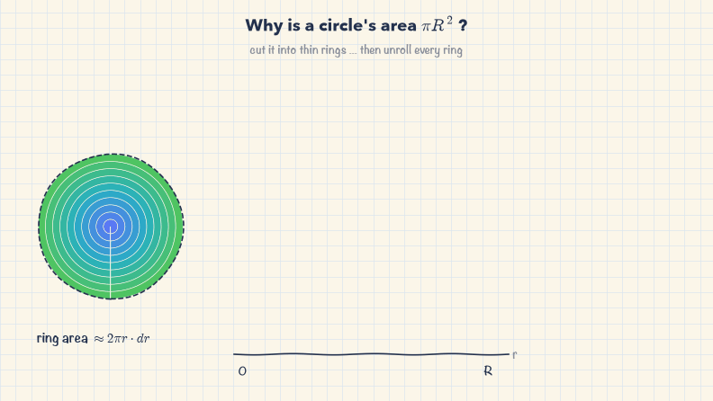
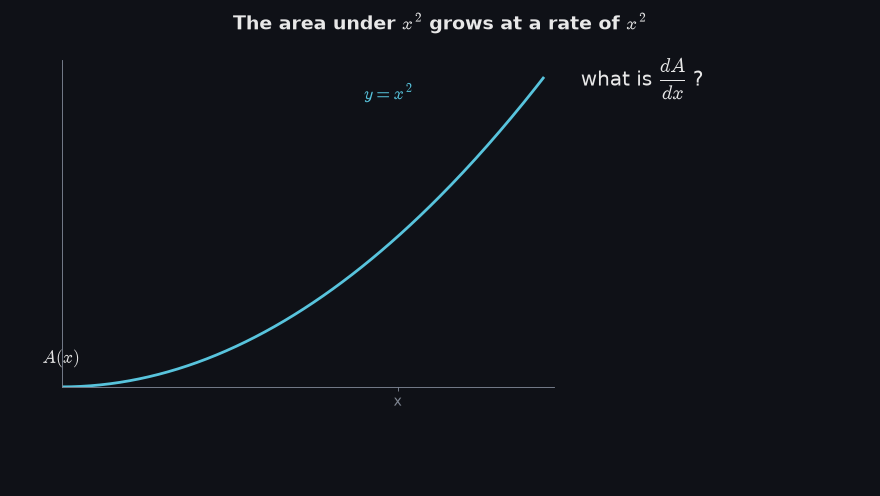
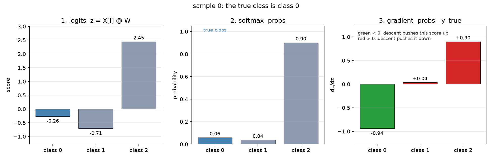
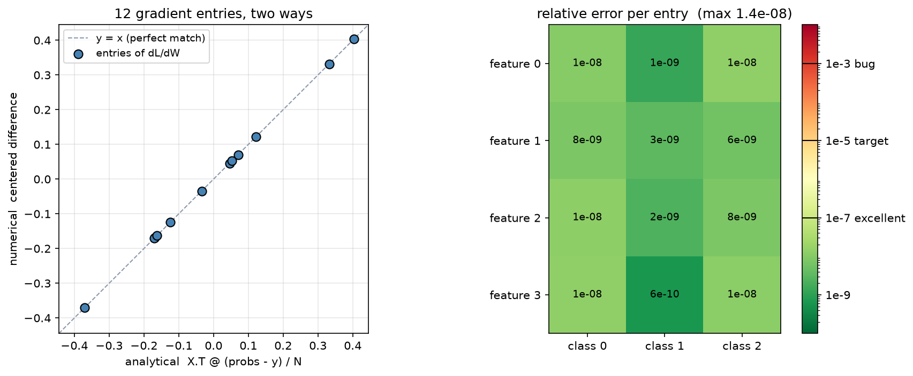
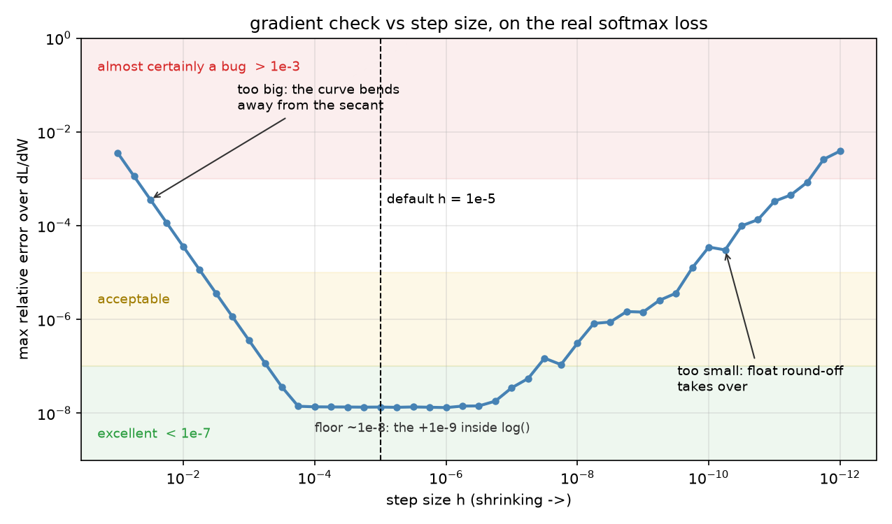
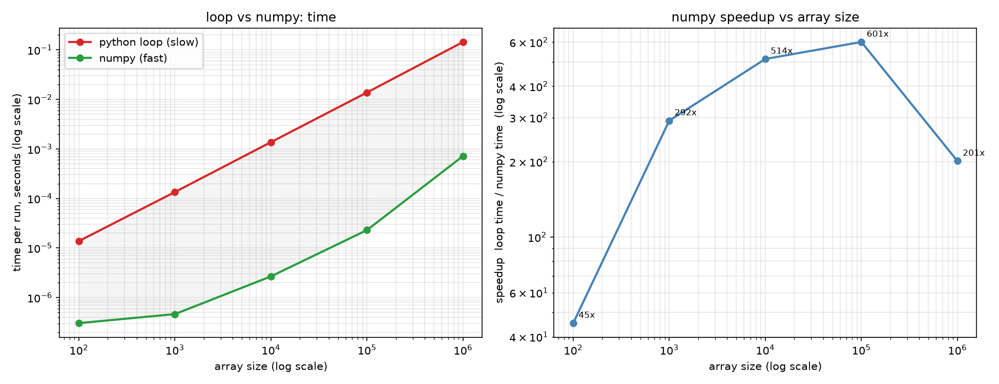

# Day 6: Gradient Checking & Vectorization Benchmarks

Gradient checking answers one question: is the gradient formula I derived actually right? It answers it with
nothing but the definition of a derivative. So before any code, here's that definition, built up from pictures.

## Start here: what a derivative really is

This is the note I made while watching 3Blue1Brown's *Essence of Calculus*:



If `A(x)` is the area under `y = x²`, then pushing `x` a tiny bit adds a thin sliver of area, `δA ≈ x² · δx`.
Rearranged, `δA / δx ≈ x²`. **The derivative is the ratio of a tiny change in output to the tiny change in input
that caused it.**

### 1. A circle is a stack of rings



Cut a circle into thin rings and straighten each one out. A ring at radius `r` becomes a strip about `2πr` long
and `dr` thick. Laid side by side, the strips form a triangle with area `½ · R · 2πR = πR²`.

Read it the other way: growing the radius by a tiny `dr` adds one more ring, `2πr · dr` of area. So the
derivative of `A = πr²` is `2πr`, the circumference.

**Why the one-sided estimate is off by `πh`.** Grow the radius from `r` to `r + h` and measure the new ring:

$$\frac{A(r+h) - A(r)}{h} = \frac{\pi(r+h)^2 - \pi r^2}{h} = \frac{2\pi r h + \pi h^2}{h} = 2\pi r + \pi h$$

The extra `πh` exists because a real ring isn't a perfectly thin strip. Its outer edge is longer than its
inner edge, so it holds a little more area than `2πr · h`. That leftover is what `πh` measures.

Notice the error is proportional to `h`: halve the step and you only halve the error. Getting close takes a very
small `h`, and that's where floating-point round-off starts to bite.

**The centered fix.** Instead, nudge both ways and measure the band from `r − h` to `r + h`:

$$\frac{A(r+h) - A(r-h)}{2h} = \frac{4\pi r h}{2h} = 2\pi r$$

The `πh²` terms cancel, because the band's outer half has a little too much area and its inner half a little
too little. For a circle this is exactly `2πr` at any `h`. That's why `numerical_gradient` uses the centered
formula.

### 2. My note, animated



The green region is `A(x)`, the area under the curve up to `x` (here `x = 1.5`). Push `x` a bit to the right and
a thin sliver gets added. That sliver is almost a rectangle, `x²` tall and `h` wide, plus a small red curved
piece on top that the rectangle misses, because the curve keeps rising across the sliver.

As `h` shrinks, that red piece shrinks faster than the rectangle, so `sliver ÷ h` gets closer and closer to `x²`.
The panel on the right plots this estimate as `h` shrinks.

**Where the numbers come from.** The exact area under `x²` is `A(x) = x³/3`, so the one-sided estimate works out
to:

$$\frac{A(x+h) - A(x)}{h} = x^2 + xh + \frac{h^2}{3}$$

The `xh` term is the red piece, and it's large. At `x = 1.5` and `h = 0.1`, the estimate is about 2.40 instead
of 2.25.

**The centered version.** Take the sliver from `x − h` to `x + h` instead. Now the rectangle misses a piece on
the right (red), where the curve rises above it, and over-counts a piece on the left (purple), where the curve
dips below it. Those two pieces are almost the same size, so they almost cancel:

$$\frac{A(x+h) - A(x-h)}{2h} = \frac{(x+h)^3 - (x-h)^3}{6h} = \frac{6x^2h + 2h^3}{6h} = x^2 + \frac{h^2}{3}$$

The `xh` terms cancel exactly. What's left, `h²/3`, comes from the curve bending: it's slightly steeper on the
right than on the left, so the red piece is a little bigger than the purple one. At `h = 0.1` that's `0.0033`,
so the estimate is 2.2533 against 2.40 for one-sided. Shrink `h` by 10× and the one-sided error drops 10×, but
the centered error drops 100×.

## The build

### The setup: a tiny classifier

Everything below runs on one small, made-up classification problem:

| name | shape | what it is |
|---|---|---|
| `X` | (5, 4) | the data: 5 samples, each described by 4 numbers (features) |
| `W` | (4, 3) | the weights: one number for every feature → class connection, 12 in total |
| `y_true` | (5, 3) | the answers, one-hot: each row has a 1 under the correct class and 0 elsewhere |

The model does three things:

1. **Scores.** `z = X @ W` gives `(5, 3)`: one raw score per class, per sample. Higher means "more likely this class".
2. **Probabilities.** `softmax(z)` turns each row of scores into probabilities that add up to 1. It raises `e`
   to each score and divides by the row total.
3. **Loss.** Cross-entropy is `−log(probability given to the correct class)`, averaged over the 5 samples. If
   the model gives the right class 100%, the loss is 0. If it gives it 6%, the loss is `−log(0.06) ≈ 2.8`.

Training means changing `W` to lower the loss, and for that you need the **gradient**: for each of the 12
weights, how much the loss changes when that weight changes a little. It has the same shape as `W`, (4, 3).

I compute that gradient two ways and check that they agree.

### 1. The slow way: nudge every weight (`numerical.py`)

This is the definition of a derivative from the calculus section, done literally. For each weight, one at a
time:

1. nudge it up by `h = 0.00001` and compute the loss;
2. nudge it down by `h` and compute the loss again;
3. put it back, and take `(loss_up − loss_down) / 2h`.

That's 24 loss calculations for 12 weights. It's slow, but it can't get the math wrong, because it never
uses any math about the model. It just measures.

`numerical_gradient(f, x, h)` takes any function `f` that returns one number, and an array `x` of any shape.
For the gradient check, `W` is flattened to 12 numbers, and `f` reshapes it back to (4, 3) and returns the loss.

One bug worth recording: my first version returned `[50000, 150000, 250000, 350000]` for the gradient of
`x²` at `[1, 2, 3, 4]` instead of `[2, 4, 6, 8]`. The input was an integer array, so `1 − 0.00001` was stored
as `0`. The function now converts the input to floats first (which also leaves the caller's array untouched).

### 2. The fast way: the formula (`analytical.py`)

Working the calculus out on paper, softmax and cross-entropy together have a surprisingly simple gradient
with respect to the scores:

```
dL/dz = probs − y_true          what the model said, minus what it should have said
```

To get the gradient for the weights, that's multiplied back through `z = X @ W` and averaged over the batch:

```
dL/dW = X.T @ (probs − y_true) / N          (4, 5) @ (5, 3) = (4, 3)
```

One matrix multiply instead of 24 loss calculations. But if I made a mistake on paper, nothing would warn me,
which is the whole reason for the check.

**What the formula means, on one sample:**



This is sample 0, whose correct answer is class 0 (blue).

- **Left, scores:** class 2 has by far the highest score (2.45). The correct class gets −0.26.
- **Middle, probabilities:** softmax turns that into 90% for class 2 and only 6% for the correct class. The
  model is confidently wrong.
- **Right, gradient:** `probs − y_true` = `[0.06, 0.04, 0.90] − [1, 0, 0]` = `[−0.94, +0.04, +0.90]`.

Training moves each score *against* its gradient. So the correct class (green, negative) gets pushed up, and
the wrong classes (red, positive) get pushed down. Each push is as big as the mistake: class 2 was 90% too
high and gets a 0.90 push, while class 1 was only 4% too high and barely moves. The bars also always add up
to zero: whatever probability is taken from the wrong classes goes to the right one.

### 3. Do the two ways agree?

They're compared with the **relative error**, one per weight:

```
|formula − nudged| / max(|formula|, |nudged|)
```

It's relative because a difference of 0.001 is huge if the gradient is 0.002, but nothing if it's 100.
Dividing by the size makes all 12 comparable. My rule of thumb:

| relative error | verdict |
|---|---|
| below 1e-7 | excellent |
| 1e-7 to 1e-5 | fine |
| 1e-5 to 1e-3 | suspicious |
| above 1e-3 | almost certainly a bug |



- **Left:** each dot is one of the 12 weights. Its x-position is the formula's answer and its y-position is
  the nudging answer. If they agree, the dot lands on the dashed line `y = x`. All 12 do. The values run from
  −0.37 to +0.40: positive means increasing that weight would raise the loss, negative means it would lower it.
- **Right:** the same 12 weights as a grid shaped like `W` (rows are the 4 features, columns the 3 classes),
  each cell showing its relative error. The color scale is logarithmic, so each step is 10×. Every cell is
  green, between 6e-10 and 1.4e-8.

**Result: max relative error 1.4e-8, mean 7.5e-9.** The worst weight is about 700× below the 1e-5 target, so
the formula is right. A real bug, like forgetting the `/ N`, would put every cell around 0.8, deep red.

### 4. How small should h be?

The check above used `h = 1e-5`. Here's what happens with every `h` from 0.1 down to 0.000000000001, each
time running the whole check and plotting the worst of the 12 errors:



`h` gets smaller to the right. The curve is a U, with three parts:

1. **Too big (left).** At `h = 0.1` the error is 4e-3, which would look like a bug even though nothing is
   wrong. A big step measures the slope of a straight line between two far-apart points, and the curved loss
   bends away from it. This error shrinks with `h²`: 10× smaller `h`, 100× smaller error.
2. **Just right (middle).** From `1e-4` to `1e-6` the error is flat at about 1.4e-8. `1e-5` is in the middle.
3. **Too small (right).** Below about `1e-7`, the error climbs back up to 4e-3. A computer keeps only about
   16 significant digits, so `loss_up` and `loss_down` become identical except in their last few digits.
   Subtracting them leaves mostly rounding noise, and dividing by a tiny `2h` blows that noise up.

**Why the floor is at 1e-8 and not lower:** my loss uses `log(probs + 1e-9)` so it never takes `log(0)`. The
nudging method measures that loss exactly, tiny `+ 1e-9` included. The formula `probs − y_true` assumes a
plain `log`. That small mismatch is the floor. Without the `1e-9`, the error drops to 3e-10.

**The lesson:** a failed gradient check isn't always a bug. With the wrong `h`, a correct gradient can fail.

### 5. Loop vs NumPy

Separate from the model: how much faster is NumPy than a plain Python loop? Both multiply two arrays of
random numbers element by element (`result[i] = A[i] * B[i]`), at 5 sizes from 100 to 1,000,000 numbers.

- **The loop** goes one element at a time in Python. Every step, Python has to fetch the two values, wrap
  them as Python objects, check their types, multiply, and store the result.
- **NumPy** (`A * B`) makes one call, then runs a tight loop in compiled C code over raw memory.

Each version is timed 3 times, and the fastest run is kept, since background activity on the computer can
only ever add time. NumPy is so fast at small sizes that each timing runs it 10 times and divides by 10.



| n | loop | numpy | speedup |
|---:|---:|---:|---:|
| 100 | 14 µs | 0.3 µs | ~45x |
| 1,000 | 0.14 ms | 0.5 µs | ~290x |
| 10,000 | 1.4 ms | 2.7 µs | ~510x |
| 100,000 | 14 ms | 23 µs | ~600x |
| 1,000,000 | 145 ms | 0.7 ms | ~200x |

*(exact numbers change a little each run)*

- **Left, the two times:** the loop (red) is a straight line, costing about 140 nanoseconds per element at
  every size. NumPy (green) is almost flat at first, because at 100 elements the fixed cost of making the
  call is nearly the whole cost.
- **Right, the ratio:** the speedup climbs as that fixed cost is spread over more elements, peaks around
  600x at 100,000, then drops to 200x at 1,000,000.

That drop surprised me. From 100k to 1M, NumPy's time grew 30x for 10x the data. My guess is memory: at 1M,
the three arrays (`A`, `B` and the result, 8 MB each) no longer fit in the CPU's small, fast cache, so NumPy
waits on slower main memory. I haven't tested that yet.

### Tests

`pytest tests -v` runs 8 tests:

1. softmax rows add up to 1, including with huge scores (×1000) that would overflow without the max-subtraction trick
2. a near-perfect prediction gives a loss near 0
3. a uniform prediction (every class equally likely) gives a loss of `log(number of classes)`
4. the gradient has the same shape as `W`
5. the gradient check passes, with max relative error below 1e-5
6. the numerical gradient works on integer input (the bug above)
7. it works on a single number (a 0-d array)
8. it doesn't change the array it's given

### Files and how to run

```
6_grad_check/
├── grad_check/
│   ├── numerical.py        numerical_gradient
│   └── analytical.py       softmax, cross_entropy_loss, forward, analytical_gradient_W
├── examples/
│   ├── run_all.py          runs every check and the benchmark, prints the results
│   ├── figures.py          draws the figures in sections 2–4
│   └── calculus_intuition.py   draws the animations at the top
├── tests/test_grad_check.py
└── figures/
```

From `6_grad_check`:

```bash
python3 examples/run_all.py               # all checks + benchmark, saves speedup_curve.png
python3 examples/figures.py               # grad_intuition, grad_check_result, h_sweep
python -m examples.calculus_intuition     # the animations
pytest tests -v
```

## Credit

The ring and sliver pictures are the ones Grant Sanderson uses in the first two chapters of
[**3Blue1Brown, *Essence of Calculus***](https://youtube.com/playlist?list=PLZHQObOWTQDMsr9K-rj53DwVRMYO3t5Yr&si=guWmcdNLRhyTxTgw).
The animations here are my own versions, but the way of seeing it is his. Watch the originals.
