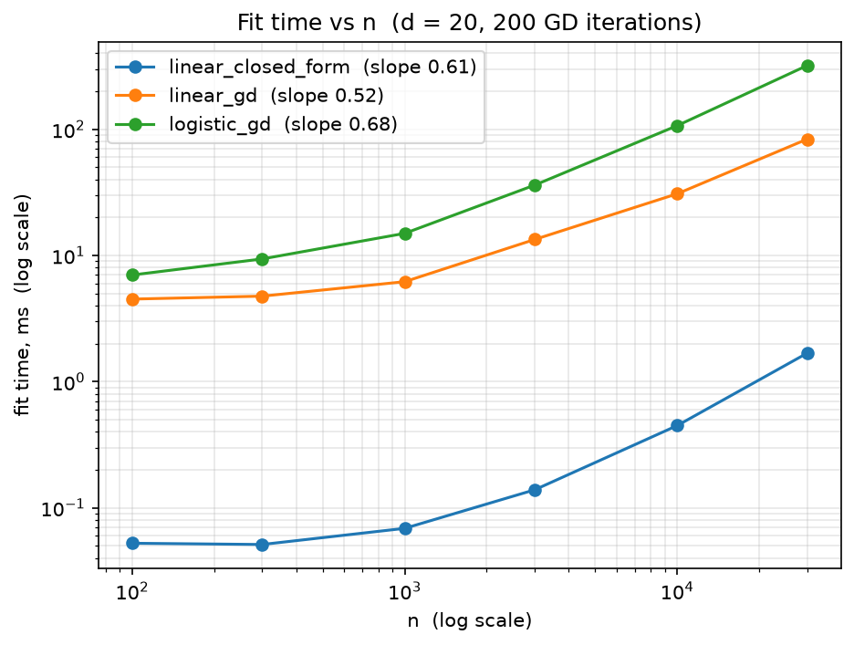
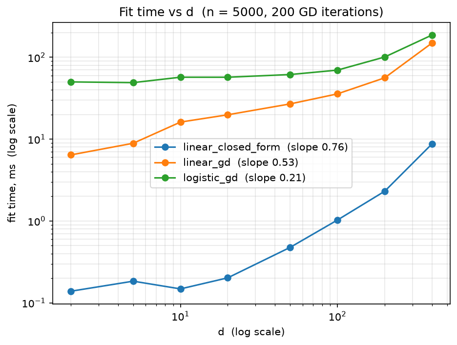
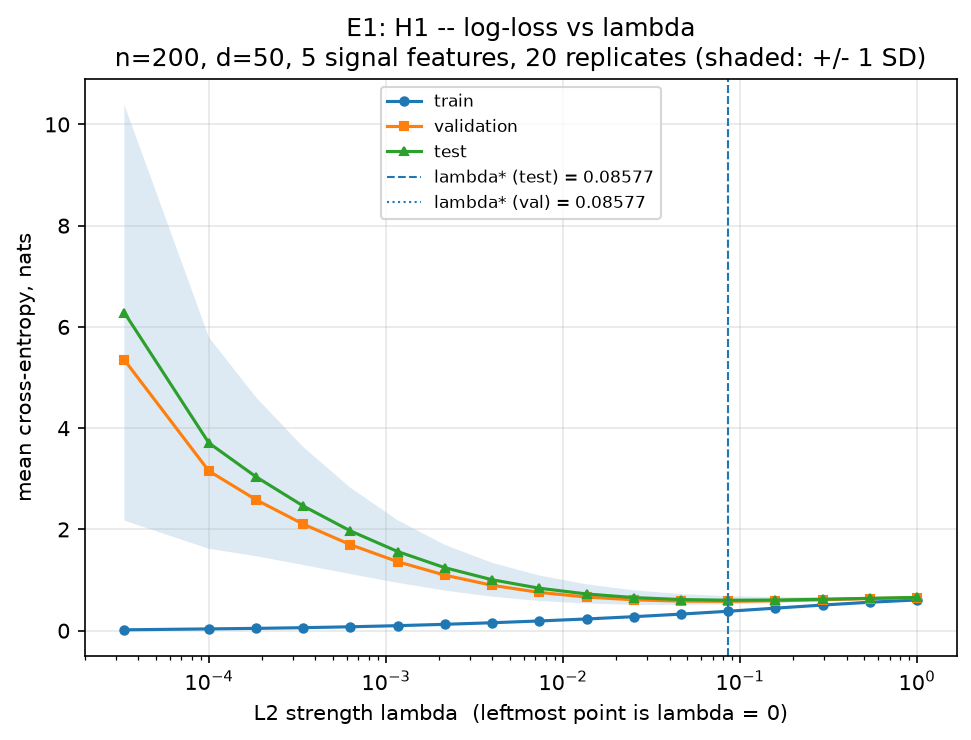
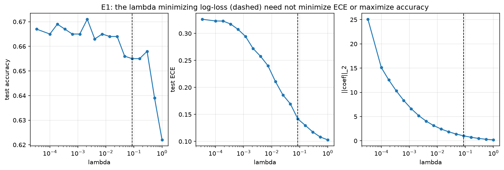
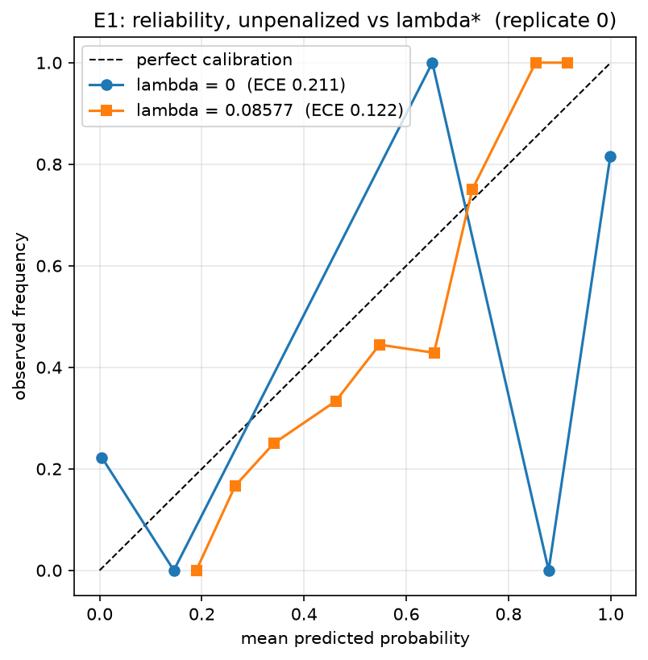
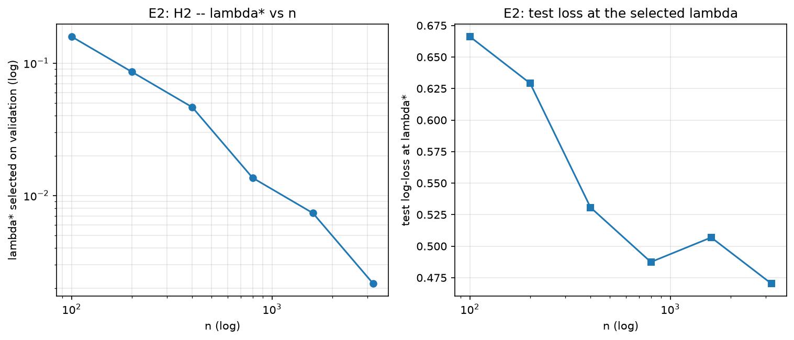
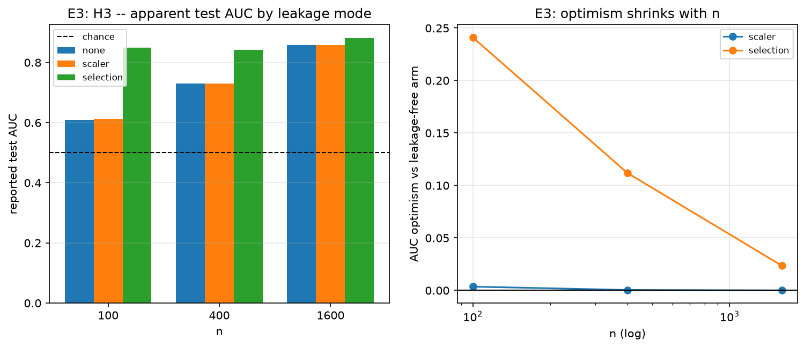

# Day 7: Probability, Statistics & Regularized Models

Day 6 checked that a gradient is correct. Day 7 asks where the loss being differentiated comes from in the first
place. The answer runs through probability:
- mean squared error is the negative log-likelihood of a Gaussian;
- cross-entropy is the negative log-likelihood of a Bernoulli;
- L2 regularization is a Gaussian prior on the weights.

So the day is built bottom-up, in three layers, and each layer uses the one before it.

```
pass 1: probability            pass 2: models                     experiments
─────────────────────          ───────────────────────            ──────────────────────────
distributions.py   MLE   ───►  losses.py   NLL objectives  ───►   run_benchmark.py   how fit time scales
bayes.py           MAP   ───►  optim.py    gradient descent       run_experiment.py  H1, H2, H3
information.py     H, KL ───►  model.py    linear + logistic
                               metrics.py  scoring
                               splits.py   train / val / test
```

Everything is NumPy only. PyTorch and scikit-learn appear in one test file, and only as answer keys.

---

## Project structure

```
7_prob_stats/
├── Makefile                    one command for everything (see below)
├── prob_stats/
│   ├── _validation.py          shared input checks (shapes, finiteness, distributions, labels)
│   ├── distributions.py        pass 1: Gaussian and Bernoulli MLE, Gaussian log-likelihood
│   ├── bayes.py                pass 1: Bayes' rule, MAP with a Beta prior
│   ├── information.py          pass 1: entropy, cross-entropy, KL divergence
│   ├── losses.py               pass 2: sigmoid, MSE and logistic objectives with gradients
│   ├── optim.py                pass 2: gradient descent
│   ├── model.py                pass 2: LinearRegression, LogisticRegression
│   ├── metrics.py              pass 2: RMSE, R², accuracy, log loss, Brier, AUC, ECE
│   └── splits.py               pass 2: train/val/test split, Standardizer
├── examples/run_all.py         a printed walk through pass 1
├── experiments/
│   ├── common.py               fixed constants, seeds, logging, synthetic data
│   ├── run_benchmark.py        timing sweeps over n and d
│   ├── run_experiment.py       the three controlled experiments
│   └── results/                benchmark.jsonl, experiment.jsonl, figures/
├── tests/
│   ├── test_prob_stats.py      pass 1
│   ├── test_models.py          pass 2, plus adversarial inputs
│   └── test_oracle.py          comparisons against PyTorch and scikit-learn
└── research-log/
```

## How to run it

Everything runs from the **repo root**, with the virtual environment active:

```bash
cd ml-foundations
source .venv/bin/activate

make -f 7_prob_stats/Makefile all          # tests, then benchmark, then experiments (~5 min)
```

Or one stage at a time:

| command | what it does | time |
|---|---|---|
| `make -f 7_prob_stats/Makefile test` | the test suite | ~3 s |
| `make -f 7_prob_stats/Makefile demo` | the printed pass 1 walkthrough | instant |
| `make -f 7_prob_stats/Makefile bench` | timing sweeps, writes `benchmark.jsonl` and 2 figures | ~10 s |
| `make -f 7_prob_stats/Makefile experiment` | E1, E2, E3, writes `experiment.jsonl` and 5 figures | ~4 min |
| `make -f 7_prob_stats/Makefile clean` | deletes `experiments/results/` and caches | |

The oracle tests skip themselves when their library is missing. To run all of them:

```bash
pip install torch scikit-learn
```

Every run is seeded from one number (`MASTER_SEED = 20261114` in `experiments/common.py`), so the results below
reproduce exactly.

---

## Pass 1: probability from scratch

### 1. Maximum likelihood for a Gaussian (`distributions.py`)

Given data $x_1, \dots, x_n$, maximum likelihood picks the $\mu$ and $\sigma^2$ that make the data most
probable. Taking logs turns the product of densities into a sum:

$$\ell(\mu, \sigma^2) = -\frac{n}{2}\log(2\pi\sigma^2) - \frac{1}{2\sigma^2}\sum_{i=1}^{n}(x_i - \mu)^2$$

- $\ell$ is the log-likelihood, in nats. Higher is better.
- The first term charges for spreading probability over a wide range.
- The second term charges for each point's squared distance from $\mu$.

`log_likelihood_gaussian` computes exactly these two terms, `log_norm` and `data_fit`. It works in log space, so
10,000 points don't underflow to zero the way a product of densities would.

Setting the derivatives to zero gives the estimates:

$$\hat\mu = \frac{1}{n}\sum_i x_i \qquad \hat\sigma^2 = \frac{1}{n}\sum_i (x_i - \hat\mu)^2$$

`mle_gaussian` returns these. The variance divides by $n$, not $n-1$. That's the MLE: slightly biased low, on
purpose. It matches `np.var(ddof=0)` and `torch.var(unbiased=False)`, and **not** the defaults of those
libraries, which divide by $n-1$. The tests check both sides of that.

On 10,000 draws from $N(5, 4)$: $\hat\mu = 4.98$, $\hat\sigma^2 = 4.05$. Moving $\mu$ by 0.5 in either direction
lowers the log-likelihood from −21,184 to −21,492, so the estimate really is the peak.

### 2. Bernoulli: MLE vs MAP (`distributions.py`, `bayes.py`)

For coin flips with $k$ heads in $n$ tosses, the MLE is just the fraction of heads:

$$\hat p_{\text{MLE}} = \frac{k}{n}$$

After 5 tails and 0 heads, that says heads is **impossible**: $\hat p = 0$. Any later $\log \hat p$ is
$-\infty$. That's overfitting in its smallest form.

MAP fixes it by adding a prior. With a $\text{Beta}(\alpha, \beta)$ prior, the posterior is
$\text{Beta}(k + \alpha,\; n - k + \beta)$, and MAP takes its peak (mode):

$$\hat p_{\text{MAP}} = \frac{k + \alpha - 1}{n + \alpha + \beta - 2} \qquad \text{when } k+\alpha > 1 \text{ and } n-k+\beta > 1$$

- $\alpha - 1$ and $\beta - 1$ act like imaginary heads and tails seen before the data.
- $\alpha = \beta = 1$ is a flat prior, which adds nothing and gives back the MLE.

`map_bernoulli` handles every shape of the posterior: hump-shaped (the formula above), flat, J-shaped (peak on a
boundary, 0 or 1), and U-shaped (no single peak, so it raises).

| prior | MAP after 5 tails |
|---|---|
| Beta(1, 1) | 0.000 |
| Beta(2, 2) | 0.143 |
| Beta(5, 5) | 0.308 |
| Beta(20, 20) | 0.442 |

A stronger prior pulls harder toward 0.5. With 500 real observations at $p = 0.2$, Beta(20, 20) only moves the
answer from 0.224 to 0.243: the data outweighs the prior. That "prior washes out as n grows" idea comes back in
experiment E2.

### 3. Bayes' rule over discrete hypotheses (`bayes.py`)

$$P(h_k \mid x) = \frac{P(x \mid h_k)\,P(h_k)}{\sum_j P(x \mid h_j)\,P(h_j)}$$

- $P(h_k)$ is the prior, the belief in hypothesis $k$ before the data.
- $P(x \mid h_k)$ is the likelihood: how well hypothesis $k$ explains the data.
- The denominator is the **evidence**, which makes the posterior sum to 1.

`bayes_update` multiplies `likelihood * prior` element-wise and divides by the sum. If the evidence is zero, no
hypothesis can explain the data, so it raises instead of returning `nan`.

In the demo, three coins ($p$ = 0.25, 0.5, 0.75) start equally likely. After H, H, H, T, H, the posterior is
`[0.026, 0.276, 0.698]`: the T pulls belief back a little, then the H pushes it on again.

### 4. Entropy, cross-entropy and KL divergence (`information.py`)

$$H(P) = -\sum_i p_i \log p_i \qquad H(P, Q) = -\sum_i p_i \log q_i \qquad \mathrm{KL}(P\,\|\,Q) = \sum_i p_i \log\frac{p_i}{q_i}$$

- **Entropy** $H(P)$ is the average surprise of outcomes drawn from $P$: 0 for a certain outcome, $\log k$ for
  $k$ equally likely ones.
- **Cross-entropy** $H(P, Q)$ is the average surprise if outcomes come from $P$ but you *expect* $Q$.
- **KL divergence** is the extra surprise: the cost of using the wrong distribution. It's never negative, and it
  isn't symmetric.

They're tied together by one identity, which `verify_relationship` checks numerically:

$$H(P, Q) = H(P) + \mathrm{KL}(P\,\|\,Q)$$

**Implementation choices:**
- **Zeros are masked, not nudged.** $0 \log 0 = 0$ is handled by summing only where $p_i > 0$, so a point mass
  has entropy exactly `0.0`, not `-1e-10`.
- **Infinity is a real answer.** If $q_i = 0$ where $p_i > 0$, the functions return `inf`. $Q$ ruled out
  something $P$ allows, and that's infinitely surprising.

**The link to classification:** with a one-hot target, $H(P) = 0$, so cross-entropy loss **is** the KL divergence
from the true label to the prediction. The demo shows both at 0.693 for a 50/50 guess.

---

## Pass 2: models built on pass 1

### 5. The two objectives (`losses.py`)

Each objective returns `(loss, gradient)` together, with the gradient derived by hand. Both are a **mean** over the
batch plus an L2 penalty. A mask $m$ (0 for the intercept, 1 for everything else) keeps the intercept unpenalized.

**Linear regression** minimizes:

$$J(\theta) = \frac{1}{n}\lVert X\theta - y\rVert^2 + \lambda \sum_j m_j \theta_j^2 \qquad \nabla J = \frac{2}{n}X^\top(X\theta - y) + 2\lambda\,(m \odot \theta)$$

The data term is the Gaussian negative log-likelihood from section 1, with constants dropped.

**Logistic regression** minimizes the Bernoulli negative log-likelihood, written in terms of the logits
$z = X\theta$:

$$J(\theta) = \frac{1}{n}\sum_i \Big[\log(1 + e^{z_i}) - y_i z_i\Big] + \lambda \sum_j m_j\theta_j^2 \qquad \nabla J = \frac{1}{n}X^\top\big(\sigma(z) - y\big) + 2\lambda\,(m\odot\theta)$$

- $\sigma(z) = 1/(1 + e^{-z})$ is the sigmoid, which turns a logit into a probability.
- $\sigma(z) - y$ is "prediction minus target", the same shape as Day 6's softmax gradient.

**Two numerical decisions:**
- **Loss from logits, not probabilities.** $\log(1 + e^{z})$ is computed with `np.logaddexp(0, z)`. Going through
  $\sigma(z)$ first would give $\log 0 = -\infty$ for confident predictions.
- **A branched sigmoid.** For $z \ge 0$ it uses $1/(1 + e^{-z})$, and for $z < 0$ it uses $e^{z}/(1 + e^{z})$. So
  `exp` never gets a large positive input and never overflows.

### 6. Gradient descent (`optim.py`)

$$\theta \leftarrow \theta - \eta\,\nabla J(\theta)$$

This repeats until the largest gradient entry is below `grad_tol`. Convergence is judged on the **gradient**, not
on the loss. A tiny change in loss can just mean a tiny step, but a near-zero gradient means you're actually at the
bottom.

The step size $\eta$ (`lr`) has a hard ceiling. Gradient descent is only stable while

$$\eta < \frac{2}{L}$$

where $L$ is the largest curvature (the largest eigenvalue of the Hessian). For linear regression that's
$L = \tfrac{2}{n}\lambda_{\max}(X^\top X) + 2\lambda$. Two things follow from this:
1. **Unscaled features break gradient descent.** One feature on the scale of $10^6$ multiplies $L$ by $10^{12}$.
   That's why the `Standardizer` exists, and a test demonstrates the failure.
2. **A large penalty does too.** The $2\lambda$ term alone means $\eta = 0.5$ can't go past $\lambda \approx 2$.
   That shaped the experiment design (see E1).

When the loss goes non-finite, `gradient_descent` raises with an explanation instead of returning `nan`.

### 7. The models (`model.py`)

**`LinearRegression`** has two solvers for the same objective:
- **`closed_form`** sets $\nabla J = 0$ and solves the resulting linear system:

  $$\big(X^\top X + n\lambda M\big)\,\theta = X^\top y$$

  Here $M = \text{diag}(m)$. The $n$ appears because the data term is a mean. With $\lambda = 0$ and fewer rows
  than features, $X^\top X$ is singular, so the code checks the rank and raises. Any $\lambda > 0$ makes the system
  solvable.
- **`gd`** runs gradient descent on $J$. A test checks it lands on the closed-form answer, which validates the
  optimizer before it's trusted on logistic regression, where no closed form exists.

After fitting, it stores the residual variance (pass 1's `mle_gaussian` on the residuals) and the training
log-likelihood (pass 1's `log_likelihood_gaussian`).

**`LogisticRegression`** only has gradient descent. Its reported training log loss goes through pass 1's
`cross_entropy_batch`, so there's one implementation of cross-entropy, not two.

### 8. L2 regularization is MAP

This is the bridge between the two passes. Put a Gaussian prior on each weight, $\theta_j \sim N(0, \tau^2)$. The
MAP objective, summed over the data, is:

$$-\sum_i \log p(y_i \mid x_i, \theta) + \frac{\lVert\theta\rVert^2}{2\tau^2}$$

The objective in `losses.py` is the same thing divided by $n$. Matching the penalty terms gives:

$$n\lambda = \frac{1}{2\tau^2} \quad\Longleftrightarrow\quad \tau^2 = \frac{1}{2n\lambda}$$

- **Bigger $\lambda$** means a tighter prior, so the weights are held closer to 0.
- **For a fixed prior belief $\tau^2$, $\lambda$ must shrink like $1/n$.** That's hypothesis H2, tested below.

It's the same mechanism as the Beta prior in section 2: pseudo-observations that the real data gradually
outweighs.

### 9. Metrics (`metrics.py`)

| metric | formula | what it tells you |
|---|---|---|
| RMSE | $\sqrt{\frac{1}{n}\sum(\hat y_i - y_i)^2}$ | typical error, in the units of $y$ |
| $R^2$ | $1 - \frac{\sum(y_i - \hat y_i)^2}{\sum(y_i - \bar y)^2}$ | share of variance explained. Negative means worse than predicting the mean |
| accuracy | share with $\mathbb{1}[\hat p_i \ge 0.5] = y_i$ | hard decisions only, and ignores confidence |
| log loss | $\frac{1}{n}\sum[\log(1+e^{z_i}) - y_i z_i]$ | punishes confident mistakes hard. Computed from logits |
| Brier | $\frac{1}{n}\sum(\hat p_i - y_i)^2$ | like log loss but bounded in [0, 1], so a few saturated predictions can't dominate |
| ROC AUC | $\frac{R_+ - n_+(n_+ + 1)/2}{n_+ n_-}$ | chance a random positive outscores a random negative |
| ECE | $\sum_b \frac{\lvert B_b\rvert}{n}\,\big\lvert \bar y_{B_b} - \bar p_{B_b}\big\rvert$ | do predicted probabilities match observed frequencies? |

Notes on the less obvious ones:
- **AUC** uses the Mann–Whitney identity: $R_+$ is the sum of the positives' ranks, with tied scores sharing their
  average rank. It's exact, $O(n \log n)$, and correct under ties. Because only the *ordering* matters, AUC can't
  see miscalibration. A test inflates every probability and AUC doesn't move, while ECE jumps. So AUC is never
  reported alone.
- **ECE** sorts predictions into 10 equal-width bins $B_b$ and compares the average prediction in each bin to how
  often the label was actually 1. The number depends on the binning, so ECEs are only compared at the same
  `n_bins`. `reliability_curve` returns the per-bin numbers behind the reliability plot in E1.

### 10. Splits and scaling (`splits.py`)

`train_val_test_split` gives each split one job:
- **train** fits the weights;
- **validation** picks hyperparameters like $\lambda$;
- **test** is used once, at the end.

Validation and test can't be the same data. Picking the best of 17 $\lambda$ values on a set makes that set's
score optimistic by construction. `stratify=y` keeps the positive rate equal across the three splits.

`Standardizer` computes $(x - \text{mean}) / \text{std}$ per feature. It has **no `fit_transform`, on purpose**.
The most common leak in practice is scaling the whole dataset before splitting, so the only way to use this class
is `fit(X_train)`, then `transform` each split. Constant features get a scale of 1.0 instead of a division by zero.

---

## Testing

| file | what it covers |
|---|---|
| `test_prob_stats.py` | pass 1: hand-checkable cases, recovering known parameters, edge cases such as `n = 1`, zeros, support mismatch, zero evidence |
| `test_models.py` | pass 2: finite-difference gradient checks (Day 6's idea), GD = closed form, metric properties, splits, and an adversarial section: separable data, collinear features, 1e6-scale features, NaN and inf, a single row, identical rows |
| `test_oracle.py` | PyTorch and scikit-learn as answer keys |

**The oracles:**
- `torch.autograd` checks every hand-derived gradient to $10^{-12}$, in float64. Torch's float32 default would
  cap agreement near $10^{-7}$, which is loose enough to hide a sign error.
- scikit-learn checks the fitted models. That first needs each library's penalty convention converted, and getting
  this wrong is a classic source of "my implementation is broken" reports that aren't:

| comparison | their convention | conversion |
|---|---|---|
| variance | numpy / torch default divide by $n-1$ | use `ddof=0` / `unbiased=False` |
| `sklearn.linear_model.Ridge` | sum of squares + $\alpha\lVert w\rVert^2$ | $\alpha = n\lambda$ |
| `sklearn.linear_model.LogisticRegression` | $\tfrac12\lVert w\rVert^2 + C\sum_i \text{loss}_i$ | $C = 1/(2n\lambda)$ |
| `torch.nn.functional.cross_entropy` | takes logits | softmax first, then compare |

A negative control passes $\alpha = \lambda$ on purpose and checks that the fit visibly disagrees. Without it, the
Ridge test could pass for the wrong reason.

Current status: **122 passed, 7 skipped.** The 7 skipped tests are the scikit-learn ones, which skip when
scikit-learn isn't installed.

---

## Benchmark: how fit time scales

`run_benchmark.py` times three fitters on standardized random data:
1. the closed form;
2. linear gradient descent;
3. logistic gradient descent.

The gradient-descent fitters run a fixed **200 iterations**, so this measures cost per unit of work, not time to
converge. Each timing is the fastest of 3 runs.

| sweep | grid | held fixed |
|---|---|---|
| B1 | n = 100 … 30,000 | d = 20 |
| B2 | d = 2 … 400 | n = 5,000 |

The **slope** in each legend is fitted on log time against log size, so it estimates the exponent in
$\text{time} \propto \text{size}^{\,\text{slope}}$.



**Time against n:**
- The closed form (blue) is far faster at every n: 1.7 ms at n = 30,000, against 84 ms for linear gradient descent
  and 320 ms for logistic, roughly 50–190×.
- All three lines are flat at small n, where fixed overhead dominates, then rise.
- Between 3,000 and 30,000 rows they grow about 6–12× for 10× more data, close to the linear growth you'd
  expect. The fitted slopes (0.5–0.7) come out low because the flat start is included in the fit.



**Time against d:** the prediction was that the closed form grows faster than linearly in d (solving a $d \times d$
system costs $d^3$) while gradient descent stays linear. **On this grid that prediction wasn't supported**: the
fitted slopes are 0.76 for the closed form against 0.53 for linear gradient descent.

The reason is that the closed form also builds $X^\top X$, which costs $n d^2$. At n = 5,000 and d = 400, that's
$8 \times 10^8$ operations against $6.4 \times 10^7$ for the solve, so the solve never dominates.
- At the top of the grid the curvature does show: from d = 100 to 400 the closed form takes 8.5× longer for 4×
  more features, while gradient descent takes 4.2×.
- Even so, the closed form never got slower than 200 gradient-descent steps (8.7 ms against 149 ms at d = 400).

---

## Experiments

`run_experiment.py` tests three hypotheses, written down before anything was run:

| | hypothesis | falsified if |
|---|---|---|
| **H1** | With n = 200, d = 50 and only 5 useful features, test log loss against $\lambda$ is U-shaped, so the best $\lambda^* > 0$ | the best $\lambda$ is 0 |
| **H2** | $\lambda^*$ falls as n grows (d fixed), because the data term grows with n and the prior doesn't | $\lambda^*$ is flat or rising |
| **H3** | choosing features on the full dataset inflates test AUC far more than fitting the scaler on it, and both inflations shrink with n | the two are similar, or the scaler leak is worse |

**How the experiments are controlled:**
- **One factor moves per experiment:** $\lambda$ in E1, n in E2, the leakage mode in E3.
- **Everything else is fixed** in `common.py` and written to the log with every run:
  - learning rate 0.5, up to 20,000 iterations, gradient tolerance $10^{-9}$;
  - 10 calibration bins;
  - 50/25/25 splits;
  - the seed scheme.
- **Paired design:** inside a replicate, every $\lambda$ sees the same dataset and the same split. So differences
  between $\lambda$ values aren't polluted by differences between datasets.
- **Synthetic data:** `make_logistic_data` draws $X \sim N(0, 1)$, gives only the first `d_signal` features a
  non-zero true weight, and samples $y \sim \text{Bernoulli}(\sigma(X w_{\text{true}}))$. Sampling the labels
  (rather than thresholding them) leaves irreducible noise, without which a U-curve couldn't exist.
- **Seeds:** every run's seed is derived from `MASTER_SEED` plus the run's coordinates, so any single run can be
  rebuilt from its log row.

**The λ grid:** 0, plus 16 values spaced evenly in log scale from $10^{-4}$ to $1$. It originally went to 10, but
with the fixed learning rate of 0.5, gradient descent diverges once $\lambda$ passes about 2 (section 6): $\lambda
= 2.15$ blew up at iteration 2,469. Capping the grid kept the optimizer settings identical across all runs, which
was the point of fixing them.

### E1: does some regularization beat none? (H1, supported)

Data: n = 200, d = 50, 5 signal features, 20 replicates.



The x-axis is $\lambda$ on a log scale, with the leftmost point standing in for $\lambda = 0$. The y-axis is the
mean cross-entropy on each split, and the shaded band is ±1 standard deviation of the test loss across the 20
replicates.

- **Train (blue)** rises steadily. The penalty stops the model from memorizing the training set, so its training
  loss can only get worse.
- **Test (green)** starts at **6.28 nats** with no penalty. The model fits noise in the 45 useless features,
  becomes confidently wrong on new data, and gets punished hard. The wide band shows how unstable that is.
- The test loss falls to **0.60 nats** at $\lambda^* = 0.086$, a 90% reduction, then starts rising again as the
  penalty begins to shrink the real signal too. That's the U-shape.
- **Validation (orange)** picks the same $\lambda$ as test. So choosing $\lambda$ honestly, on validation, loses
  nothing here.



The same sweep through three other lenses, with the dashed line at $\lambda^*$:
- **Accuracy (left)** barely moves: 0.66–0.67 until $\lambda \approx 0.03$, then it drops. It ignores confidence
  entirely, which is why it can't see the 6.28 → 0.60 improvement in log loss.
- **ECE (middle)** falls the whole way, from 0.33 to 0.10. Its minimum is at the edge of the grid ($\lambda = 1$),
  so the best-calibrated $\lambda$ may lie beyond what was tested. The lesson stands either way: **the $\lambda$
  that predicts best isn't the one that's best calibrated**, which is why both are reported.
- **Weight size, $\lVert w\rVert_2$ (right),** shrinks from 25 to about 1 at $\lambda^*$. That's the penalty doing
  its job.



This is a reliability diagram for one replicate. Each point is one bin of test predictions:
- the x-axis is the average predicted probability in the bin;
- the y-axis is how often the label was actually 1;
- a perfectly calibrated model sits on the dashed diagonal.

**Unpenalized (blue)** zig-zags wildly: it predicts close to 0 or 1, and those predictions are often wrong (ECE
0.211). **At $\lambda^*$ (orange)** the points follow the diagonal much more closely (ECE 0.122).

### E2: how does λ\* move with n? (H2, supported)

Data: d = 50 fixed, n from 100 to 3,200, 10 replicates per n. At each n, $\lambda^*$ is chosen on
**validation**.



| n | 100 | 200 | 400 | 800 | 1,600 | 3,200 |
|---|---|---|---|---|---|---|
| $\lambda^*$ | 0.159 | 0.086 | 0.046 | 0.014 | 0.0074 | 0.0022 |
| test log loss | 0.666 | 0.629 | 0.531 | 0.487 | 0.507 | 0.470 |

- **Left:** $\lambda^*$ falls at every step, so the rank correlation with n is exactly −1. On log-log axes the
  slope is about −1.2. Section 8 predicts −1 for a fixed prior ($\tau^2 = 1/(2n\lambda)$), so the data asks for a
  slightly weaker prior as it grows.
- **Right:** the test loss at the chosen $\lambda$ improves with more data, as it should. The bump at 1,600 is
  most likely replicate noise (10 replicates per n).

### E3: which leak hurts more? (H3, supported)

Data: d = 200 features with 5 real ones. The model keeps the top 20 features by correlation with y, uses
$\lambda = 0.01$, and runs 20 replicates per n. There are three arms:

| arm | feature selection uses | scaler fitted on |
|---|---|---|
| none (correct) | training rows | training rows |
| scaler leak | training rows | **all rows** |
| selection leak | **all rows** | training rows |



**Left:** the reported test AUC for each arm. The dashed line at 0.5 is a coin flip.

| n | none | scaler leak | selection leak |
|---|---|---|---|
| 100 | 0.609 | 0.612 | 0.850 |
| 400 | 0.730 | 0.731 | 0.842 |
| 1,600 | 0.858 | 0.858 | 0.881 |

**Right:** each leak's AUC minus the correct arm's, which is the size of the lie.
- **The scaler leak is almost harmless** (+0.004 at most). It leaks only a mean and a standard deviation per
  feature.
- **The selection leak is severe:** +0.24 at n = 100. Among 195 pure-noise features, some correlate with the test
  labels by chance. Selecting on all rows hands the model exactly those, already tuned to the test set.
- Both leaks shrink as n grows, because chance correlations shrink with more data.

At n = 100, an honest 0.61 gets reported as 0.85. So "we scaled before splitting" is a minor sin, but "we selected
features on the whole dataset" invalidates the number.

---

## What I'd look at next

- Re-run E1 with a smaller fixed learning rate and the grid extended to 10, to find where ECE actually bottoms out.
- Extend B2 to d in the thousands, where the $d^3$ solve should finally beat the $n d^2$ build.
- Add grouped splitting. `train_val_test_split` splits rows, which leaks when rows come in groups, such as
  repeated measures on the same person.

The day's decisions and dead ends are in the [research log](research-log/2026-11-16.md).
