# day 8: one neural network, built three times

i wanted to know exactly what pytorch does for me before letting it do it. so today i built the same kind of network three times, and each time i handed one more job to the library:

| phase | what i write myself | what the library does | data |
|---|---|---|---|
| 1. `numpy_mlp/` | everything: forward, backward, optimizers, dropout | nothing, it's numpy | MNIST |
| 2. `torch_raw/` | parameters, updates, grad resets | autograd does the backward pass | MNIST |
| 3. `torch_nn/` | the model and the experiments | nn.Module, torch.optim, schedulers, amp, hooks | CIFAR-10 |

each phase has to match the one before it. phase 2 has to reproduce phase 1's accuracy and gradients, otherwise one of them is wrong. phase 3 then uses the full library on a harder dataset.

**the data**
- **MNIST:** 70k grayscale handwritten digits, 28×28, 10 classes. i split the 60k training set 48k / 6k / 6k into train / val / test, and keep the official 10k test set untouched until the very end.
- **CIFAR-10:** 60k color photos, 3×32×32, 10 classes (airplane, cat, ship ...). i use 45k for training, 5k for validation, and the official 10k as the test set.
- both download themselves into `data/` on first use, and neither is in the repo.

**the headline numbers**
- MNIST 10k test: numpy 97.96%, raw torch 97.91%.
- autograd and my phase 1 backward agree with zero error.
- CIFAR-10 test: 90.50% with a small cnn. the target was 85%.

**what's below:** setup and every command, the folder map, then the day in order (phase 1 → 2 → 3) with each figure where it belongs and what to read in it, how to load the saved results, and the tests. the reasoning behind the decisions is in the [research log](research-log/2026-11-20.md).

---

## setup

you need python 3.10+. everything installs from the repo root:

```bash
git clone https://github.com/Prodholly/ml-foundations.git
cd ml-foundations
python -m venv .venv
source .venv/bin/activate
pip install -e ".[dev]"          # numpy, matplotlib, pillow, torch, torchvision, pytest
```

i used torch 2.15 and torchvision 0.29 on an apple m2.
- **device:** the code picks `cuda`, then `mps`, then `cpu` by itself.
- **optional graph rendering:** for the torchviz version of the compute graph, also run `pip install torchviz` and `brew install graphviz`. without them i draw the graph myself with matplotlib.

**every command runs from inside `8_pytorch/`:**

```bash
cd 8_pytorch

# phase 1, numpy
python -m numpy_mlp.figures                 # activations.png, no data needed
python -m numpy_mlp.init_experiment         # init_comparison.png              ~1 min
python -m numpy_mlp.run                     # the >97% run + confusion matrix  ~15 s

# phase 2, raw torch
python -m torch_raw.verify_autograd         # autograd vs my backward, prints the errors
python -m torch_raw.run                     # the >97% run on the best device (add `cpu` to force cpu)
python -m torch_raw.visualize_graph         # compute_graph.png

# phase 3, nn.Module on CIFAR-10 (first run downloads ~170 MB)
python -m torch_nn.run_cifar10              # the final benchmark, ~15 min on an m2 (`mlp` instead of the cnn)
python -m torch_nn.models.init_nn           # init_nn_comparison.png
python -m torch_nn.training.optimizers_nn   # optimizer_comparison.png
python -m torch_nn.training.amp_nn          # fp32 vs fp16 timing and memory   ~2 min
python -m torch_nn.training.schedulers_nn   # scheduler_comparison.png, instant
python -m torch_nn.models.activations_nn    # nn_activations.png, instant

# small demos that just print
python -m torch_nn.models.mlp                     # named_parameters, buffers, train vs eval, .half()
python -m torch_nn.training.regularization_nn     # dropout, batchnorm, layernorm, dropout2d, clipping
python -m torch_nn.training.checkpointing_nn      # save, load, resume gives the identical loss
python -m torch_nn.training.reproducibility_nn    # same seed same curve, new seed new curve
python -m torch_nn.debugging.hooks                # forward / backward hooks + anomaly detection
python -m torch_nn.debugging.grad_check           # Day 6's checker and torch.autograd.gradcheck on an nn.Module
python -m torch_nn.debugging.profile_nn           # torch.profiler table
python -m torch_nn.advanced.custom_autograd       # ClippedReLU + gradcheck
python -m torch_nn.advanced.custom_losses         # label smoothing and focal loss vs the built-ins
```

```bash
# tests, from the repo root
cd .. && pytest 8_pytorch/tests -q
```

---

## the map

```
8_pytorch/
├── numpy_mlp/          phase 1, pure numpy
│   ├── data.py           MNIST download, idx parsing, normalize, one-hot, batch_generator, the splits
│   ├── activations.py    relu, gelu, swish, softmax, each with its backward
│   ├── init_schemes.py   gaussian 0.01, xavier, he, lecun
│   ├── losses.py         cross-entropy, the fused softmax + ce gradient (p - y) / N, mse
│   ├── layers.py         LinearLayer: forward caches X, backward returns dX and stores dW, db
│   ├── model.py          NumpyMLP: stacks layers + activations, forward / backward / zero_grad
│   ├── optimizers.py     SGD momentum, Adam, AdamW from their update equations
│   ├── regularization.py L1, L2, inverted dropout with a cached mask
│   ├── trainer.py        minibatch loop, early stopping that restores the best weights, confusion matrix
│   ├── init_experiment.py, run.py, figures.py
│   └── mlp_scratch.py    my first single-file version, kept as the starting point
├── torch_raw/          phase 2, tensors + autograd, no nn.Module
│   ├── tensors.py        warm-up: creation, dtypes, devices
│   ├── layers.py         RawLinear: W and b are plain leaf tensors
│   ├── verify_autograd.py  my phase 1 formulas vs loss.backward()
│   ├── model.py          RawMLP + a hand-written cross_entropy
│   ├── optimizers.py     SGD momentum, Adam, AdamW with in-place updates under no_grad
│   ├── regularization.py dropout and batch norm with plain-tensor running stats
│   ├── trainer.py        phase 1's loop + register_hook grad logging + device memory
│   ├── visualize_graph.py, run.py
├── torch_nn/           phase 3, the full library, CIFAR-10
│   ├── data.py           CIFARDataset, transforms, WeightedRandomSampler, DataLoaders
│   ├── models/           mlp.py, cnn.py, activations_nn.py, init_nn.py
│   ├── training/         optimizers_nn, schedulers_nn, regularization_nn, amp_nn,
│   │                     checkpointing_nn, reproducibility_nn, trainer_nn (the Trainer class)
│   ├── debugging/        hooks, grad_check, profile_nn, loss_landscape
│   ├── advanced/         custom_autograd (ClippedReLU), custom_losses (label smoothing, focal)
│   └── run_cifar10.py    the final benchmark
├── tests/              95 tests across all three phases
├── figures/            every png below
├── results/            every number below, as json
└── full_task.md        the brief i worked from
```

---

## phase 1: numpy, where every equation is mine

a 784 → 256 → 128 → 10 network on flattened MNIST digits. the forward pass is `Z = X @ W.T + b` and an activation, layer after layer. the backward pass is the chain rule written out by hand:

```
dL/dZ = (softmax(Z) - Y) / N        the loss gradient, derived by hand first
dL/dW = dL/dZ.T @ X                 (out, in)
dL/db = dL/dZ.sum(0)                (out,)
dL/dX = dL/dZ @ W                   (N, in), handed to the layer below
```

every one of those is gradient-checked against Day 6's finite-difference checker in the tests.

**activations.** the activation is what makes the network more than one big matrix multiply. its derivative decides whether a unit can keep learning.

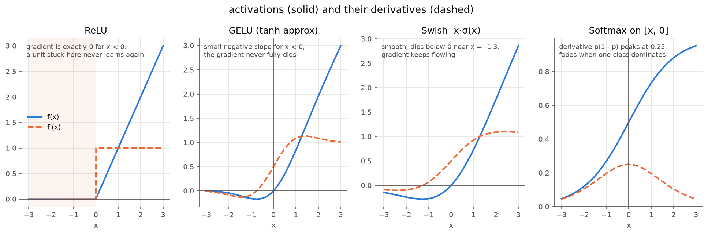

- **how to read it:** each panel is one activation. solid is f(x), dashed is its derivative f′(x).
- **relu:** the shaded half has f′ = 0. a unit whose input stays negative gets no gradient, so it never updates again (a "dead" relu).
- **gelu and swish:** both curve slightly below zero and keep a small gradient there, so they never fully die.
- **softmax:** the last panel shows how one logit becomes a probability against a fixed rival. its derivative peaks at 0.25 and fades at both ends, which is why a confidently wrong network learns slowly.

**initialization.** the starting weights set how big the signal and the gradient are when they pass through each layer.

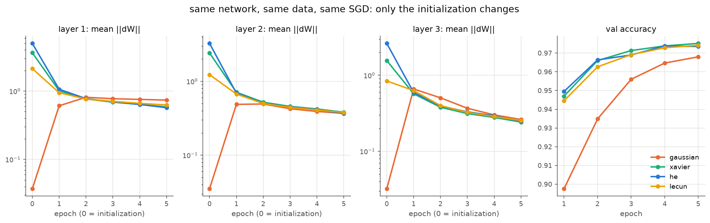

- **the setup:** the same network, data and plain SGD with momentum for every line; only the init changes.
- **how to read it:** the first three panels are the gradient size per layer, on a log scale. epoch 0 is the first batch, before any weight has moved. the last panel is validation accuracy.
- **gaussian 0.01:** its step-0 gradient is ~0.04 against ~5 for he, about 130× smaller. the signal shrinks a little at every layer and has almost vanished by the time it comes back.
- **the outcome:** momentum digs gaussian out within an epoch, but it stays behind on accuracy (96.8% after 5 epochs against ~97.4% for xavier, he and lecun).
- **why plain SGD:** Adam would have hidden this. it divides every step by the gradient's own size, so tiny gradients still produce normal-sized steps.

**the full run.** he init, relu, Adam (lr 1e-3), L2 1e-4, batch 128, early stopping with patience 5.

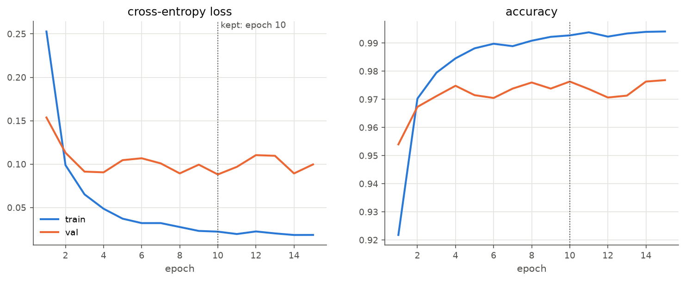

- **how to read it:** blue is train, orange is validation.
- **what happened:** train loss keeps sinking while validation loss flattens around 0.09 after epoch 3. that gap is the model starting to memorize.
- **early stopping:** the dotted line is the epoch with the best validation loss. training stopped at 15 and the weights from epoch 10 were put back.
- **result:** **97.96%** on the untouched 10k test set, at ~0.97 s per epoch. the most common mistake is a 4 read as a 9.

---

## phase 2: tensors and autograd, nothing else

the same network, but W and b are now torch tensors with `requires_grad=True`.
- **no backward method:** `loss.backward()` fills `W.grad` for me.
- **what i still own:** the update (`p -= lr * p.grad` inside `torch.no_grad()`), the optimizer state, zeroing the gradients, dropout, and batch norm.
- **what's not allowed:** no nn.Linear, no nn.Module, no torch.optim.

**first, a proof.** `verify_autograd.py` builds one layer in float64 and computes the gradients twice. once by hand with the three formulas above, once by autograd. then it does the same against phase 1's `LinearLayer.backward()`, starting from identical weights.

```
manual formulas:        dW 0.00e+00   db 0.00e+00   dX 0.00e+00
phase 1 LinearLayer:    dW 0.00e+00   db 0.00e+00   dX 0.00e+00
```

the error isn't small, it's zero, so phase 1's math is exactly what autograd does. my raw SGD, Adam and AdamW also match `torch.optim` to ~1e-7 after 25 steps, and my raw batch norm matches `nn.BatchNorm1d`.

**what autograd actually records.** every operation in the forward pass leaves a node behind. backward walks those nodes in reverse, applying the chain rule at each one.

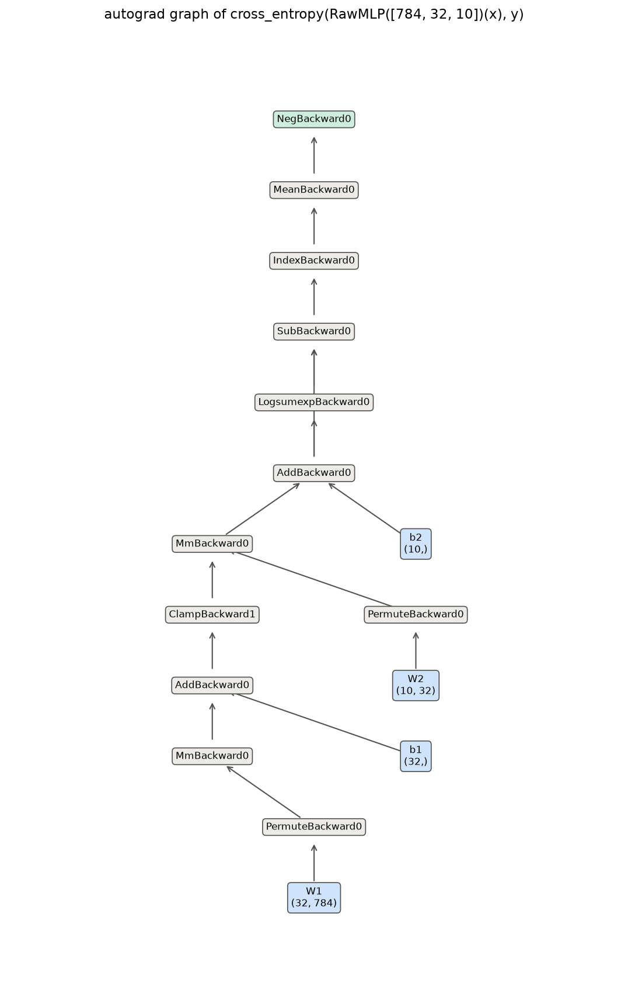

- **how to read it:** it's a 784 → 32 → 10 network. read bottom-up, which is the order the forward pass ran.
- **blue boxes:** the parameters (leaves), the tensors that receive `.grad`.
- **grey boxes:** one per operation:
  - `PermuteBackward` is `W.T`;
  - `MmBackward` is `@`;
  - `AddBackward` is `+ b`;
  - `ClampBackward` is relu;
  - the top five are my cross-entropy: logsumexp, subtract, pick the true class, mean, negate.
- **the point:** it's phase 1's backward, recorded instead of written.

**the run.** the exact config and data split of phase 1.

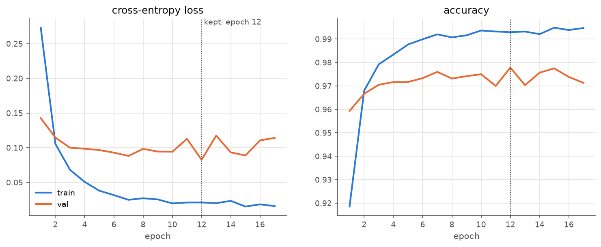

- **how to read it:** the same layout as phase 1's curves.
- **what to notice:** it looks almost the same, which is the point. a real difference here would mean my optimizers drifted from phase 1's.
- **result:** **97.91%** on the 10k test (best epoch 12). it took 0.57 s per epoch on cpu and 0.46 s on mps, against 0.97 s for numpy.
- **why mps barely helps:** a 235k-parameter network on batches of 128 is too small to keep the gpu busy.

**watching the gradients.** a `register_hook` on every weight records the gradient's size on every backward pass.

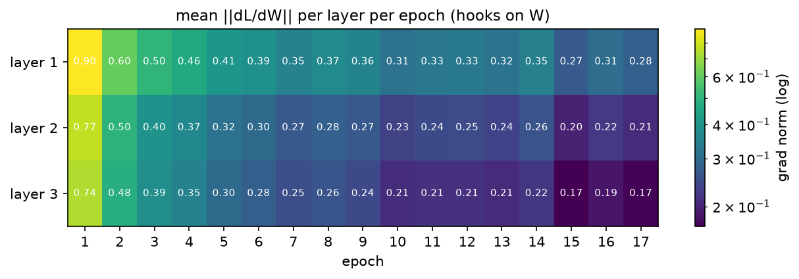

- **how to read it:** one row per layer, one column per epoch. each cell is the mean gradient size.
- **what it shows:** every layer starts near 0.8 and cools to ~0.2 as the loss falls. no layer collapses to zero or blows up, which is healthy flow.
- **if init or depth went wrong:** you'd see one row much darker than the others.

---

## phase 3: the full library, on a dataset where the naive approach fails

CIFAR-10 is where shortcuts stop working. the images are in color, the objects sit anywhere in the frame, and the classes look alike. this phase uses everything pytorch offers:
- **data:** a custom `Dataset` with augmentation (random flips, crops and color jitter on training images only).
- **model:** `nn.Module` with ModuleList, Sequential, buffers, `named_parameters`, train/eval, `.half()`.
- **initialization:** `nn.init`.
- **training:** `torch.optim` with lr schedulers, mixed precision with `GradScaler`, gradient clipping.
- **reliability:** checkpoints that resume exactly, and seeding that reproduces a run bit for bit.
- **debugging:** forward / backward hooks, anomaly detection, the profiler, a loss landscape.
- **advanced:** a custom `autograd.Function` and two custom losses.
- **putting it together:** a reusable `Trainer` class.

**the same activations, through `nn.functional`.**

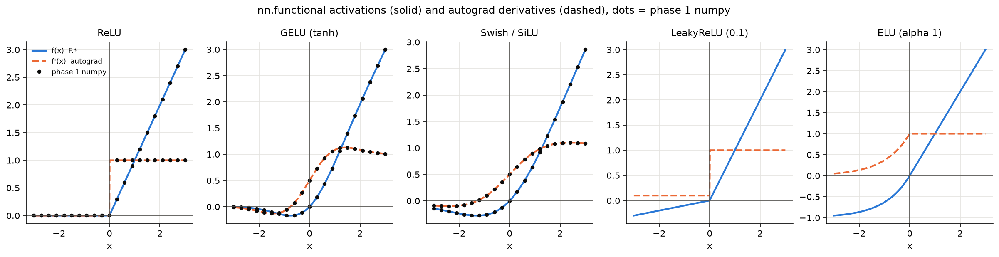

- **how to read it:** solid is `F.relu`, `F.gelu`, `F.silu` and so on. dashed is the derivative computed by autograd.
- **the black dots:** phase 1's numpy values. they sit right on the lines, so my hand-derived derivatives match pytorch's.
- **leaky relu and elu:** new here. both keep a nonzero slope below zero.

**`nn.init` on CIFAR-10.** this repeats phase 1's experiment with pytorch's init functions.

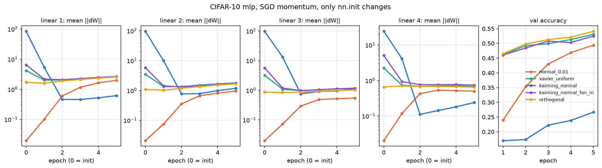

- **the setup:** a 3072 → 1024 → 512 → 256 → 10 MLP, SGD momentum, 5 epochs.
- **the surprise, kaiming fan_out:** the brief's `kaiming_normal_(mode="fan_out")` did worst of all (26.7%). its step-0 gradients are ~90 against ~4 for xavier.
  - fan_out scales each layer by its number of outputs. this network narrows down to 10 outputs, so the last layer's weights come out 5× too large.
  - the first SGD steps then blow up and kill most of the relus.
- **the fix, fan_in:** phase 1's he, `kaiming_normal_fan_in`, gets 52.5%. that's level with xavier (53.1%) and orthogonal (54.1%).
- **normal 0.01:** vanishes at the start again, like in phase 1, and ends at 49.4%.
- **the lesson:** fan_in vs fan_out is not a detail for a network that narrows.

**optimizers.** the same model, init and batches. only `torch.optim` changes.

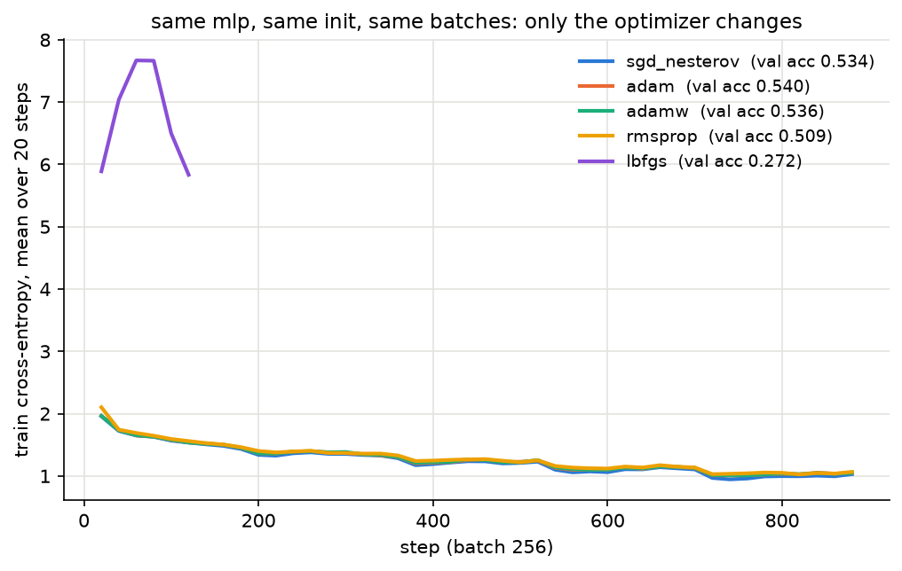

- **how to read it:** training loss over steps, averaged every 20 steps. the legend shows the final validation accuracy.
- **the first-order four:** SGD-nesterov, Adam, AdamW and RMSprop are almost on top of each other (51–54%). after a good init, the optimizer mattered much less than the init did.
- **lbfgs (purple):** it diverges. its line search assumes the same loss function every step, and minibatches give it a slightly different one each time.

**learning-rate schedules.** a schedule changes the step size during training.

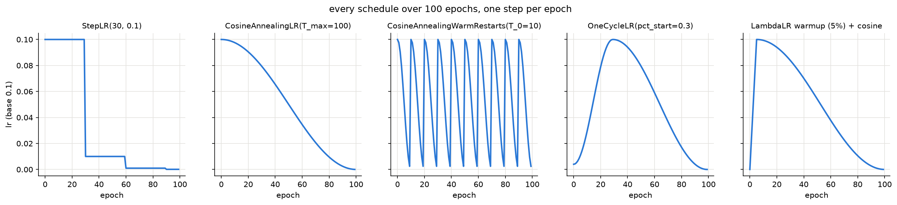

- **how to read it:** each panel is the learning rate over 100 epochs.
- **StepLR:** cuts the rate 10× every 30 epochs.
- **cosine:** decays smoothly to zero.
- **warm restarts:** jumps back up every 10 epochs, to shake the model out of a sharp minimum.
- **OneCycle:** climbs first, then decays far below its start. the final run uses this one.
- **warmup + cosine:** ramps up over the first 5%, then decays. it's built with `LambdaLR`, which needed a `partial`: LambdaLR passes only the step number, but my function takes three arguments.

**the small demos, as numbers instead of plots**
- **dropout:** off in eval mode. in train mode it zeroes about half the units and doubles the rest.
- **dropout2d:** drops whole channels at once.
- **batch norm:** the running stats move in train mode and freeze in eval mode.
- **layer norm:** handles a batch of one, which batch norm refuses.
- **gradient clipping:** brought a total gradient norm of 6083 down to exactly 1.
- **checkpointing:** 5 epochs, save, load into fresh objects, 5 more. the loss is identical to 10 straight epochs, to the last digit. that only works because the random number generator states are saved too.
- **gradient checks:** Day 6's checker on an `nn.Module` gives a relative error of ~1e-9. `torch.autograd.gradcheck` agrees.
- **ClippedReLU:** my custom `autograd.Function` passes gradcheck.
- **custom losses:** label smoothing matches `F.cross_entropy(label_smoothing=0.1)`. focal loss with γ = 0 equals plain cross-entropy.
- **profiler:** 88% of a cnn forward pass on cpu is spent in the convolutions.
- **mixed precision on the m2:** fp16 uses 27% less memory (3.0 vs 4.1 GB), but it's not faster (58 vs 54 s per epoch). the m2 gpu has no tensor cores. on an nvidia card the same code is usually about twice as fast.

### the final benchmark

the brief's recipe:
- he init, relu, AdamW (wd 0.01);
- OneCycleLR (max lr 3e-3);
- dropout 0.3, batch norm, mixed precision;
- gradient clipping at 1.0;
- label smoothing 0.1;
- 30 epochs, batch 256.

**one change:** the model is a cnn, not an MLP. an MLP flattens the image into 3072 numbers and loses which pixels sit next to each other, so it stalls around 55–60% on CIFAR-10. a convolution slides the same small filter over every position, so an edge detector learned in one corner works everywhere.

the cnn (`models/cnn.py`) is small: 4 conv stages, 2 residual blocks, 1.6M parameters, ~26 s per epoch on mps.

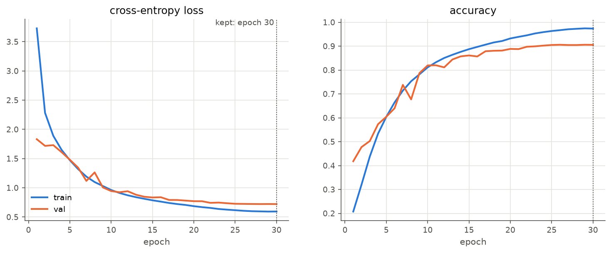

- **how to read it:** the same layout as before.
- **early epochs:** validation beats train. the training images are augmented and run with dropout on, so they're harder than the clean validation images.
- **later:** the curves cross around epoch 6. validation accuracy levels off near 90.5% while train reaches ~97%.
- **best epoch:** the best validation loss is at the last epoch, so a few more epochs would likely still help.

**result: 90.50% on the 10k test set** (the target was 85%).

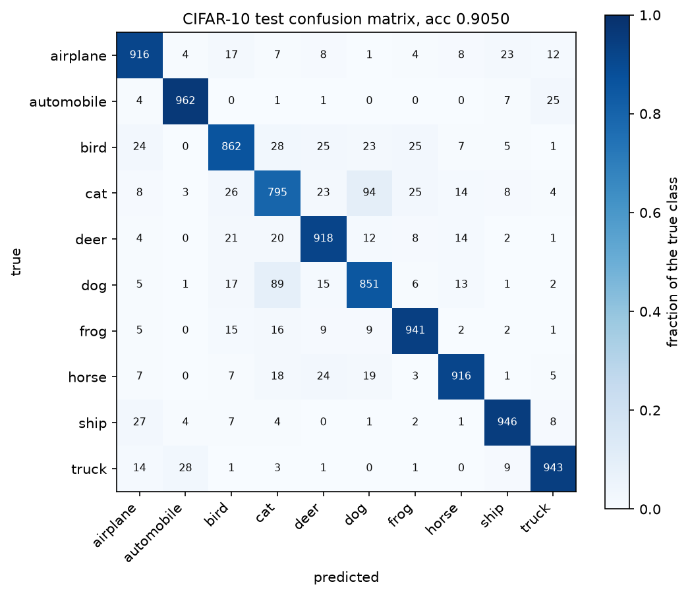

- **how to read it:** row = the true class, column = the prediction, each cell a count out of 1000. a perfect model would have 1000s on the diagonal and zeros everywhere else.
- **the easy classes:** automobile (962), ship (946) and truck (943).
- **the hard pair:** cat and dog, confused 94 and 89 times, the main source of error.
- **the next biggest:** truck → automobile (28) and ship → airplane (27). the mistakes are pairs that look alike at 32×32, not random noise.

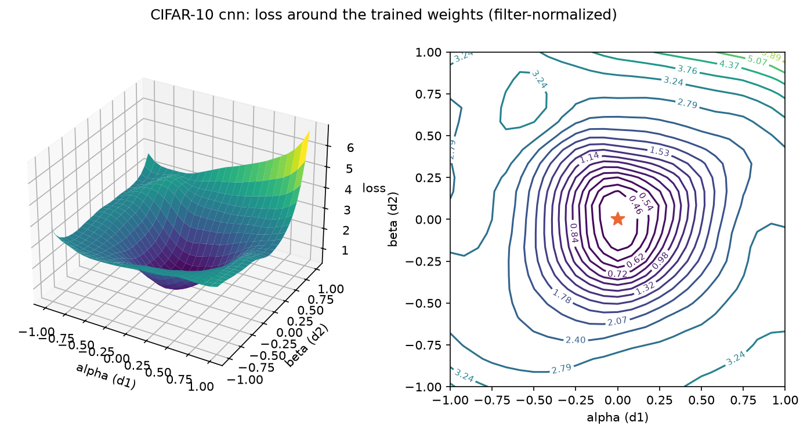

- **what it shows:** the loss on one fixed batch as the trained weights are pushed along two random directions. the star is the trained model.
- **filter normalization:** each direction is rescaled, filter by filter, to the size of the weights it pushes. otherwise a step of 1.0 would mean something different for big and small layers.
- **how to read it:** the model sits at the bottom of a single, fairly round basin. the loss is 0.40 there and rises smoothly to ~3 at the edges.
- **why it matters:** a wide, smooth basin usually means the model doesn't hinge on exact weight values, which tends to go with good generalization.

---

## loading the results

every number above is saved as json in `results/`, so you can check it without training anything:

```python
import json
r = json.load(open("8_pytorch/results/cifar10_run.json"))
r["test"]                       # {'loss': 0.7304, 'acc': 0.905}
r["history"]["val_acc"]         # per-epoch curves
r["confusion_matrix"]           # 10 x 10, rows true
```

| file | what's in it |
|---|---|
| `numpy_run.json` | phase 1 config, per-epoch curves and times, both test scores, confusion matrix |
| `torch_raw_run_cpu.json`, `_mps.json` | the same for phase 2, plus device memory per epoch |
| `init_comparison.json`, `init_nn_comparison.json` | gradient norms per layer per epoch, val accuracy, per scheme |
| `optimizer_comparison.json` | loss every 20 steps and final val accuracy, per optimizer |
| `cifar10_run.json` | config, full history, test score, confusion matrix, landscape min / max |

the trained weights aren't in the repo, because they're too big. running `python -m torch_nn.run_cifar10` writes them to `checkpoints/cifar10_best.pt`. to load them:

```python
import torch
from torch_nn.models.cnn import CNN
model = CNN(widths=(32, 64, 128, 256))
ckpt = torch.load("checkpoints/cifar10_best.pt", map_location="cpu", weights_only=False)
model.load_state_dict(ckpt["model_state_dict"])
model.eval()
```

`weights_only=False` is needed because the checkpoint also holds the optimizer, scheduler and random number generator states. only use it on files you wrote yourself, because unpickling can run code.

## tests

`pytest 8_pytorch/tests -q` from the repo root runs **95 tests** in a few seconds:
- **phase 1:** every gradient is checked against Day 6's finite differences. also data shapes, normalization, one-hot rows, init variances, optimizer directions and Adam's bias correction, dropout fractions.
- **phase 2:** autograd vs my formulas, raw optimizers vs `torch.optim`, raw batch norm vs `nn.BatchNorm1d`.
- **phase 3:**
  - data: normalized range, batch shapes, disjoint splits, the weighted sampler balancing a 9:1 set;
  - models: output shapes, the parameter count formula, deterministic eval;
  - regularization: dropout and batch norm modes, clipping;
  - plus gradcheck, the custom losses, the warmup schedule, exact checkpoint resume and seeding.

the one CIFAR test that reads real images skips itself if the dataset hasn't been downloaded.

---

why i made each choice, what broke and what i'd do differently: [research log](research-log/2026-11-20.md).
